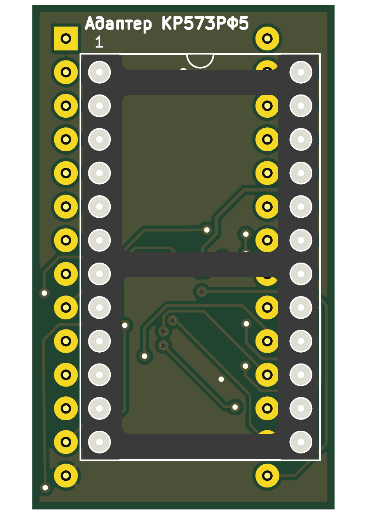
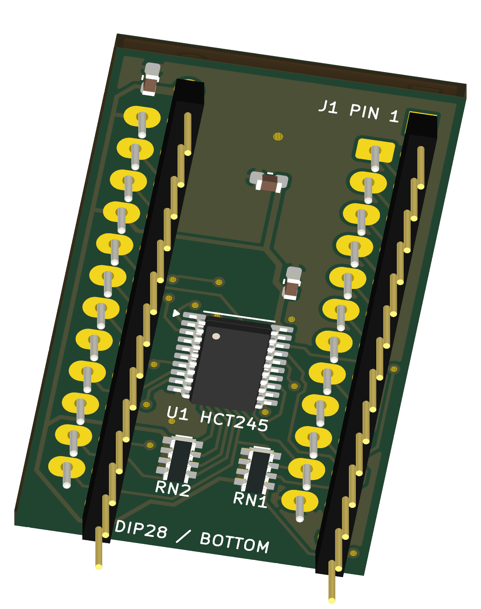
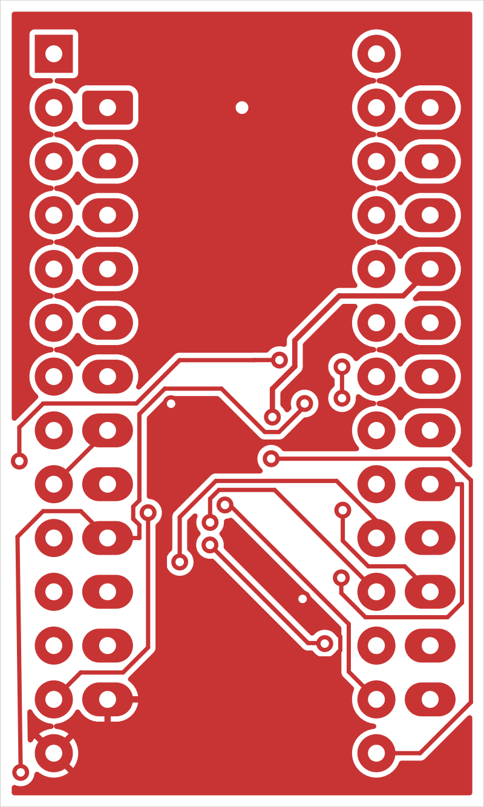
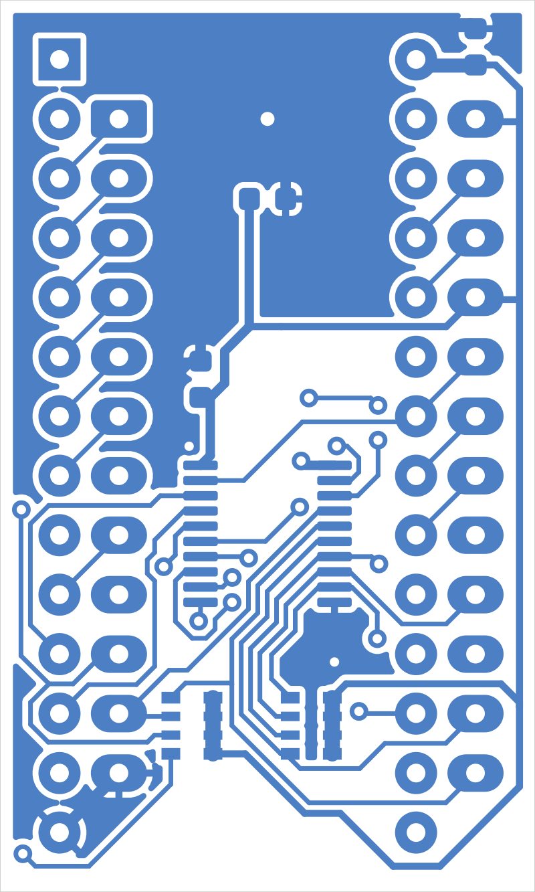

# Компактный адаптер КР573РФ5 для Dumper Lite

Откройте `KR573RF5_Adapter.kicad_pro`, затем схему или плату. Это отдельный **полностью разведённый двухслойный адаптер 22,86 × 38,10 мм**, только для чтения на 5 В. Сверху — панелька DIP-24, снизу — два ряда круглых контактов «папа» для установки в DIP-28 панельку EPROM дампера. Шаг контактов 2,54 мм, расстояние между рядами 15,24 мм.

## Конструкция и детали

| Поз. | Деталь | Монтаж |
|---|---|---|
| J1 | Два ряда **1×14 круглых штырей**, подходящих для DIP-панельки, шаг 2,54 мм | Снизу, длинные контакты направлены вниз |
| J2 | Панелька DIP-24, 600 mil / 15,24 мм между рядами | Сверху; выемка совпадает с обозначением pin 1 |
| U1 | **SN74HCT245PW**, TSSOP-20, 4,4×6,5 мм, шаг 0,65 мм | Снизу |
| C1 | 100 нФ, X7R, ≥16 В, 0603 | Снизу, возле питания EPROM |
| C2 | 100 нФ, X7R, ≥16 В, 0603 | Снизу, возле питания U1 |
| C3 | 1 мкФ, X7R, ≥10 В, 0603 | Снизу |
| RN1, RN2 | **CAY16-473J4LF**, 4 независимых резистора по 47 кОм в каждой сборке, 3,2×1,6 мм, convex | Снизу; слабые подтяжки данных RF5 к +5 В |

Подойдёт HCT245 другого производителя с **той же распиновкой и TSSOP-20 4,4×6,5 мм**. Не заменяйте на обычный HC245: его входные уровни другие. Точная марка панельки и контактных полос не выбрана; сверяйте шаг, диаметр ножек, высоту и механические габариты перед покупкой. Квадратные штыри 0,64 мм от стандартной гребёнки нельзя силой вставлять в прецизионную DIP-панельку. Наиболее удобны круглые контакты примерно 0,45–0,50 мм или подходящие контакты DIP-переходника, рассчитанные на вашу панельку.

Верхняя панелька смещена на 2,54 мм вправо и на один шаг вниз относительно начала нижнего разъёма. Так её 24 отверстия не совпадают с 28 отверстиями нижнего разъёма и данные можно пропустить через буфер. Нижний буфер находится между рядами контактов. Плата без дополнительных крепёжных отверстий.

Пластиковая опора нижних контактных полос должна обеспечивать зазор **не менее 2,5 мм** между нижней поверхностью адаптера и верхней поверхностью панельки дампера: под адаптером стоят SMD-детали. Выбирайте длину контактов с достаточным рабочим заходом в панельку после учёта этого зазора. Выступающие **сверху** хвосты J1 перед установкой J2 обрежьте заподлицо и проверьте, что они не мешают корпусу J2. Две панельки/полосы изображены габаритными моделями; окончательная механическая совместимость требует проверки реальных деталей.

## Зачем нужен буфер

В опубликованном техническом листке КР573РФ5 указана минимальная выходная «1» 2,55 В. Вход ATmega328P при питании 5 В требует для гарантированной «1» минимум 0,6×VCC, то есть 3 В. Поэтому простая перепайка DIP-24 на DIP-28 не даёт гарантии чтения.

HCT245 принимает TTL-уровни: минимальная входная «1» 2 В по [Texas Instruments SN74HCT245](https://www.ti.com/lit/ds/symlink/sn74hct245.pdf), разделы 5–6. Его выходы питаются от тех же 5 В и подходят для ATmega. Порт A получает данные RF5, порт B подаёт их в дампер; DIR, pin 1, постоянно подключён к +5 В. OE#, pin 19, соединён с OE# EPROM и дампера, поэтому при HIGH буфер отключается. Резисторы подтяжки CE#/OE# уже есть в Lite и повторно на адаптере не установлены. Пороги ATmega: [Microchip ATmega328P, DC characteristics](https://ww1.microchip.com/downloads/aemDocuments/documents/MCU08/ProductDocuments/DataSheets/Atmel-7810-Automotive-Microcontrollers-ATmega328P_Datasheet.pdf).

Когда RF5 отключает свои выходы, восемь входов A буфера всё равно должны иметь определённый уровень. RN1/RN2 задают слабую подтяжку каждого RF5_D0…D7 к +5 В. При выходном LOW нагрузка одного резистора около 0,11 мА; при отключённой EPROM входы буфера остаются HIGH. Используются **изолированные** резисторы 1–8, 2–7, 3–6, 4–5, а не сборка с общей ножкой. Тип, шаг 0,8 мм и габариты проверены по [Bourns CAT/CAY16](https://www.bourns.com/docs/Product-Datasheets/CATCAY.pdf). Посадка KiCad имеет общую ширину земель 2,6 мм, в диапазоне рекомендованных 2,4–2,8 мм для CAY16-J4. На стороне MCU при отключённом буфере следует включить внутренние подтяжки входов данных.

## Распиновка

Нумерация J1 и J2 здесь дана **при взгляде сверху на собранный адаптер**, выемками вверх. Для DIP-28 слева сверху вниз идут 1…14, справа сверху вниз — 28…15. Для DIP-24 слева — 1…12, справа — 24…13. При взгляде на нижнюю сторону левый и правый ряды меняются местами визуально, номера электрических контактов не меняются.

| Вывод J2 / RF5 | Сигнал | Подключение |
|---|---|---|
| 1 | A7 | J1.3 |
| 2 | A6 | J1.4 |
| 3 | A5 | J1.5 |
| 4 | A4 | J1.6 |
| 5 | A3 | J1.7 |
| 6 | A2 | J1.8 |
| 7 | A1 | J1.9 |
| 8 | A0 | J1.10 |
| 9 | D0 | U1.2 → U1.18 → J1.11 |
| 10 | D1 | U1.3 → U1.17 → J1.12 |
| 11 | D2 | U1.4 → U1.16 → J1.13 |
| 12 | GND | J1.14, U1.10 |
| 13 | D3 | U1.5 → U1.15 → J1.15 |
| 14 | D4 | U1.6 → U1.14 → J1.16 |
| 15 | D5 | U1.7 → U1.13 → J1.17 |
| 16 | D6 | U1.8 → U1.12 → J1.18 |
| 17 | D7 | U1.9 → U1.11 → J1.19 |
| 18 | CE# | J1.20 |
| 19 | A10 | J1.21 |
| 20 | OE# | J1.22, U1.19 |
| 21 | VPP / Uпр | **+5 В для чтения**, J1.28 |
| 22 | A9 | J1.24 |
| 23 | A8 | J1.25 |
| 24 | VCC | +5 В, J1.28, U1.20 |

J1.1, .2, .23, .26, .27 не используются: это старшие адреса A15/A12/A11/A13/A14 у NM27C512. Память RF5 — **2048 байт**, адреса 0…2047. При чтении всех 65536 адресов NM27C512 её 2 КиБ будут повторяться 32 раза.

## Сборка и чтение

1. Паяйте нижние SMD-компоненты, проверьте питание и ориентацию U1.
2. Припаяйте круглые нижние контакты через выравнивающий шаблон с шагом 15,24 мм между рядами. Не нагревайте хорошую панельку дампера длительной пайкой через вставленные в неё контакты. Проверьте перпендикулярность и отсутствие перекоса.
3. Уберите верхние выступы J1 под корпусом J2, затем поставьте верхнюю панельку. При домашнем изготовлении без металлизации сначала выполните все переходы и нужные двухсторонние соединения сквозных площадок.
4. Без EPROM прозвоните питание, каждый адрес, CE# и OE#. RF5_D0…D7 и ROM_D0…D7 не должны быть замкнуты напрямую: между ними U1.
5. Вставьте адаптер в выключенный Lite, совместив первые выводы. Сначала проверьте на пустой панельке наличие 5 В на J2.21/.24 и GND на J2.12. Затем отключите питание и установите RF5.
6. Прошивка должна держать D0…D7 **входами с внутренними подтяжками**, выставлять адрес A0…A10, активировать CE#/OE#, ждать доступа и считывать байт. Для первого запуска используйте не менее 1 мкс после стабилизации адреса/управления; опубликованный листок указывает доступ до 420 нс, дополнительно есть задержка буфера. Читайте 2048 байт дважды и сравнивайте результаты.

Не подавайте 25 В на адаптер, не запускайте программирование, не включайте направление данных «MCU → EPROM». VPP RF5 на этой плате жёстко соединён с 5 В. В полной Stage 2 версии допустимость установки требует заранее проверенного режима чтения с питанием цели 5 В и отсутствием внешнего VPP; безопасный целевой проект для этого адаптера — Lite.

Существующие Stage 2 прошивка, профили и утилита не изменялись. Профиль RF5 в них остаётся заблокированным до получения исходного заводского документа; адаптер не добавляет автоматически поддержку RF5 в прошивку Lite. Здесь создана аппаратная плата для согласованного режима чтения, а не новый программный протокол.

## GND-полигоны для уменьшения травления

На обеих сторонах (`F.Cu` и `B.Cu`) добавлены и заполнены сплошные зоны сети **GND**. Зазор до других цепей — **0,25 мм**, минимальная ширина меди зоны — **0,25 мм**, отступ границы зоны от контура — **0,55 мм**. У площадок включены терморазвязки: зазор 0,25 мм, перемычки 0,30 мм. Изолированные участки, не связанные с GND, удаляются.

Существующие дорожки, переходы, компоненты, контур и пользовательская графика сохранены. Добавлен один сквозной переход GND (центр X=61,43 мм, Y=55,08 мм, площадка 1,20 мм, отверстие 0,60 мм), связывающий большой верхний участок заливки с нижним полигоном. При домашнем изготовлении пропаяйте в нём медную проволоку с обеих сторон. Сохранность исходных объектов подтверждена сравнением всех узлов PCB после удаления только новых зон и нового перехода; отчёт — `validation/gnd_zones_audit.json`. Промежуточная резервная копия до заливки удалена при очистке 12.10.2026; основной PCB и отчёт сохранены. Gerber-файлы и 3D-предпросмотры обновлены с заполнением.

После последующих изменений разводки нажимайте **B** в PCB Editor для перезаполнения зон перед экспортом.

## Проверка и файлы производства

Текущая проверка KiCad 10.0.6 после добавления GND: **электрических ошибок 0; неразведённых связей 0; расхождений платы со схемой 0**. Сохранены 16 предупреждений `silk_over_copper` о пользовательской графике поверх площадок U1 — они были в файле до добавления зон. Новых нарушений DRC нет. Отчёты — `validation/drc_before_gnd_zones.json`, `drc.json`, `gnd_zones_audit.json`. ERC схемы — 0; `validation/connectivity_audit.json` относится к первоначальной проверке адаптера до последующих пользовательских правок. Маршрутизация выполнялась локально; плата не отправлялась внешнему сервису.

В `KR573RF5_Adapter.kicad_dru` есть одно узкое механическое правило: разрешено размещение J2 над обрезанными заподлицо хвостами J1. Правило относится только к их courtyard; проверки электрических зазоров, отверстий и прочих компонентов действуют. Это конструктивное условие сборки, а не скрытое подавление электрических ошибок.

В `fabrication/` находятся Gerber-файлы обоих слоёв, маски, надписей, контура, Excellon-сверловка и SVG-карта отверстий. Это **заводские файлы с металлизированными отверстиями**, без зеркальности и инверсии для домашнего фоторезиста. Технология изготовления дома описана в `../docs/PCB_Photoresist_RU.md`.

Схема и оба 3D-вида просмотрены. Собранный адаптер и чтение реальной микросхемы не испытаны.

## Источники и статус КР573РФ5

Распиновка, TTL-уровни и время доступа взяты из двухстраничного [технического листка КР573РФ5](https://storage.ua.prom.st/1093634_kr573rf5.pdf), опубликованного поставщиком «Электроника и Связь». Это **листок поставщика, не подтверждённый оригинальный заводской паспорт**. Подключение VPP к 5 В в режиме чтения согласуется с указанным в нём пределом Uпр для чтения 5,25 В и схемой чтения [Intel 2716](https://deramp.com/downloads/mfe_archive/050-Component%20Specifications/Intel/Memory%20Components/Intel%202716.pdf); последнее — инженерное сопоставление совместимой распиновки, не доказательство идентичности алгоритмов программирования. Номера всех 24 выводов проверены по опубликованному рисунку RF5. Перед установкой редкой микросхемы сверяйте её точное обозначение и паспорт.

Стандартные символы и модели корпусов KiCad имеют лицензию KiCad Libraries CC BY-SA 4.0 с исключением для электронных проектов. Локальные RF5/буферные символы и посадка нижнего разъёма находятся в проекте. Модель нижних круглых контактов — созданный для этого проекта условный геометрический образ, а не CAD конкретного изготовителя.
