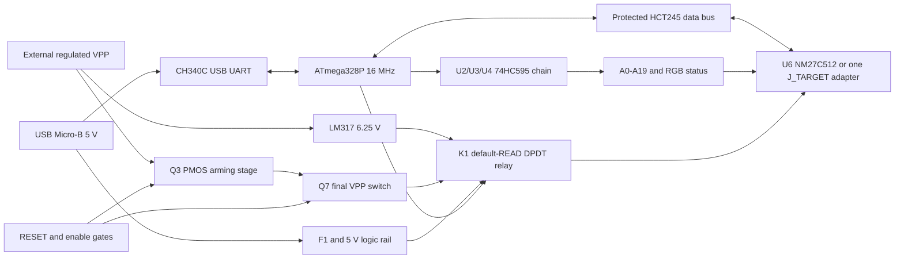

# Lunar Dumper / Lunar Writer

Актуальные устройства проекта:

- **[Lunar Dumper](Dumper-Lite/NM27C512_Dumper_Lite.kicad_pro)** — минимальный USB-дампер, 5 В, чтение EPROM. Пользовательская разводка сохранена; обновлены названия и идентификатор прошивки. [Инструкция](Dumper-Lite/README.md), [прошивка 115200](firmware/lite/README.md).
- **[Lunar Writer, Rev. 1](Lunar-Writer/Lunar_Writer.kicad_pro)** — новая полностью разведённая двухслойная плата **150×105 мм**, ATmega/CH340/DIP-28, буфер данных, коммутация VCC/VPP и отдельная винтовая клемма **12–24 В DC**. [Описание и настройка](Lunar-Writer/README.md), [схема PDF](Lunar-Writer/Lunar_Writer_Schematic.pdf), [3D](Lunar-Writer/Writer_3D.png), [Gerber/drill](Lunar-Writer/production/). ERC/DRC/соответствие схеме: 0 замечаний; 0 неразведённых связей. Аппаратная наладка ещё не выполнена, штатная WRITE заблокирована.
- **[LunarView 3, 1.2](app-win_forms/README.md)** — Windows Forms: чтение, HEX/ASCII, открытие ROM-файлов и сравнение. Сборка: `app-win_forms/release/LunarView3.exe`. Сейчас работает с протоколом Lunar Dumper; Writer обслуживается прежней утилитой `tools/eprom_tool.py`, 57600 бод.
- **[Адаптер КР573РФ5](Adapter-KR573RF5/README.md)** — отдельная плата только для чтения, не для программирования через Writer.
- [Изготовление фоторезистом](docs/PCB_Photoresist_RU.md), [источники 3D-моделей](docs/3D_Models_RU.md).

Проверка от 12.10.2026: новую плату Writer проверили отдельно. У сохранённого пользовательского Dumper остаются прежние 2 неразведённые связи и 16 предупреждений (15 изолированных участков меди, 1 незавершённая дорожка); переименование их не изменило. До домашнего изготовления Dumper следует закончить эту проверку. Медные слои и геометрия Dumper при работе над Writer не менялись; доказательство — `validation/lunar-products-2026-10-12/rename-audit.json`.

Файлы `NM27C512_Dumper.*` в корне и `baseline_readonly/` сохранены как исторические проекты Stage 2 / раннего read-only. Полноценный актуальный программатор открывается из **Lunar-Writer**. Ниже приведены сведения старой Stage 2: там J4 являлся входом готового VPP, а повышающего преобразователя не было. Для нового питания и калибровки Writer используйте его README.

## Historical Stage 2 architecture



USB supplies all 5 V logic, the CH340 and relay. J4 accepts regulated VPP_IN on pin1 and GND on pin2, expected 12.5-25 V depending on the exact profile. +6V25_PROG is generated from that supply with LM317T. K1 selects target +5 V / +6.25 V and separately selects socket pin22 OE logic / VPP_SW. Normal RESET and power-on use the unenergized READ contacts. VPP and elevated target VCC have no direct connection to an AVR GPIO.

Old NMOS EPROMs can have TTL output-high specifications below the AVR's 5 V CMOS input threshold. Stage 2 therefore uses **SN74HCT245DW**, with TTL-compatible inputs; a 74HC245 is not an equivalent substitute here. Both sides have 1k resistors and external BAT54S clamps. The read-only baseline keeps the requested direct NM27C512 data connection. Target outputs during 6.25 V byte verify are clamped on the buffer side. MCU releases its outputs before VPP_DRIVE changes the bus direction.

## ATmega328P-AU TQFP32 map

PB1, originally reserved for an interlock, now explicitly controls HV_ARM_EN. PB4/MISO is used only by ISP. ADC6/ADC7 are analog-only package pins.

| Package pin | Function | Net |
| --- | --- | --- |
| 1 | PD3 | PROG_MODE |
| 2 | PD4 | ROM_D6 |
| 3 | GND | GND |
| 4 | VCC | +5V |
| 5 | GND | GND |
| 6 | VCC | +5V |
| 7 | PB6 / XTAL1 | XTAL1 |
| 8 | PB7 / XTAL2 | XTAL2 |
| 9 | PD5 | ROM_D7 |
| 10 | PD6 | TARGET_CE_PGM# |
| 11 | PD7 | TARGET_OE# |
| 12 | PB0 | TARGET_PGM# |
| 13 | PB1 | HV_ARM_EN |
| 14 | PB2 | ADDR_LATCH |
| 15 | PB3 / MOSI | ADDR_SER |
| 16 | PB4 / MISO | ISP_MISO |
| 17 | PB5 / SCK | ADDR_SCK |
| 18 | AVCC | +5V |
| 19 | ADC6 | VPP_SENSE |
| 20 | AREF | AREF |
| 21 | GND | GND |
| 22 | ADC7 | TARGET_VCC_SENSE |
| 23 | PC0 | ROM_D0 |
| 24 | PC1 | ROM_D1 |
| 25 | PC2 | ROM_D2 |
| 26 | PC3 | ROM_D3 |
| 27 | PC4 | ROM_D4 |
| 28 | PC5 | ROM_D5 |
| 29 | PC6 / RESET | RESET |
| 30 | PD0 / RXD | UART_RX |
| 31 | PD1 / TXD | UART_TX |
| 32 | PD2 | VPP_EN |

## Address and status chain

U2 SER is PB3/MOSI. U2 Q7S (pin9) goes to U3 SER (pin14), then U3 Q7S to U4 SER. All three share pin11 SRCLK=ADDR_SCK/PB5 and pin12 RCLK=ADDR_LATCH/PB2; SRCLR# pin10=+5V, OE# pin13=GND, VCC16=+5V and GND8=GND. R7 pulls LATCH down during RESET/ISP, keeping ISP shifts from latching. CE/OE/PGM pull-ups keep the target inactive while addresses are unspecified at initial power-up.

| Output | U2 | U3 | U4 |
|---|---|---|---|
| Q0 / pin15 | A0 | A8 | A16 |
| Q1 / pin1 | A1 | A9 | A17 |
| Q2 / pin2 | A2 | A10 | A18 |
| Q3 / pin3 | A3 | A11 | A19 |
| Q4 / pin4 | A4 | A12 | STATUS_RED |
| Q5 / pin5 | A5 | A13 | STATUS_GREEN |
| Q6 / pin6 | A6 | A14 | STATUS_BLUE |
| Q7 / pin7 | A7 | A15 | NC / reserved |

Send U4 byte first, U3 next and U2 last, MSB first, then latch. The high byte's low nibble is A16-A19; bits4/5/6 are active-low RGB R/G/B; bit7 remains LOW. Firmware preserves RGB state on every address update and masks unused upper addresses LOW for smaller profiles. The baseline sends only U3 then U2.

## Direct U6 socket: NM27C512 DIP28

Use only a correctly oriented NM27C512 or verified compatible read part in U6. Footprint is `Package_DIP:DIP-28_W15.24mm_Socket_LongPads`; it suits a conventional 600 mil socket. Verify the selected ZIF socket's body/lever clearance before PCB layout rather than assuming every ZIF is mechanically identical.

| Pin | Net | Pin | Net |
| --- | --- | --- | --- |
| 1 | A15 | 28 | TARGET_VCC |
| 2 | A12 | 27 | A14 |
| 3 | A7 | 26 | A13 |
| 4 | A6 | 25 | A8 |
| 5 | A5 | 24 | A9 |
| 6 | A4 | 23 | A11 |
| 7 | A3 | 22 | SOCKET_OE_VPP |
| 8 | A2 | 21 | A10 |
| 9 | A1 | 20 | TARGET_CE_PGM# |
| 10 | A0 | 19 | TARGET_D7 |
| 11 | TARGET_D0 | 18 | TARGET_D6 |
| 12 | TARGET_D1 | 17 | TARGET_D5 |
| 13 | TARGET_D2 | 16 | TARGET_D4 |
| 14 | GND | 15 | TARGET_D3 |

In READ, TARGET_VCC=+5V and SOCKET_OE_VPP follows TARGET_OE#. In PROGRAM, TARGET_VCC=+6.25V and SOCKET_OE_VPP=VPP_SW. Pin20 CE/PGM# is the programming-pulse input. R2/R3/R8 pull CE/OE/PGM HIGH from the logic rail during RESET. K1 physically disconnects the MCU OE path from VPP.

## Headers and UART

J2 is the standard AVR ISP 2x3: pin1 MISO, 2 +5V, 3 SCK, 4 MOSI, 5 RESET, 6 GND. J3 is a 1x3 header: **1 GND, 2 RX (MCU PD0), 3 TX (MCU PD1)**. An external UART TX goes to J3 RX and external RX to J3 TX. Use 5 V TTL and avoid simultaneous active TX sources.

CH340C TXD pin2 goes through R4=1k to MCU RX; MCU TX goes through R5=1k to CH340 RXD pin3. WCH pins: 1 GND, 4 V3 (C3 only), 5 UD+, 6 UD-, 7 NC, 8 OUT#/optional DTR2 (unused), 9 CTS#, 10 DSR#, 11 RI#, 12 DCD#, 13 DTR#, 14 RTS#, 15 R232=GND, 16 VCC=+5V. Every unused output/input has an explicit NC marker. CH340C has an internal oscillator: there is no 12 MHz crystal.

DTR# reaches RESET through C13=100nF, not directly. R1 is the 10k 0603 pull-up, SW1 resets to GND, and ISP RESET is the same net. D9 clamps a positive DTR-release spike on RESET, which also feeds the 5 V interlock inputs.

J1 uses `Connector_USB:USB_Micro-B_Molex-105017-0001`; buy that pad-compatible receptacle. Pins1/2/3/4/5 are VBUS/D-/D+/NC/GND. Shield pad SH=GND. USB VBUS reaches the logic rail through the 1812 500 mA hold polyfuse. The complete circuit can exceed 100 mA, especially with an old EPROM and the 100 mA relay coil. Use a stable USB source whose permitted current covers the load; assess USB descriptor/current and inrush compliance during product engineering. The polyfuse is not an active inrush limiter.

## J_TARGET 2x20 expansion pinout

Odd numbers are the symbol's left column; even numbers are right. Data pins expose the protected **target side** of U9, not the bare MCU pins. Populate U6 or one adapter, never both.

| Odd pin | Net | Even pin | Net |
| --- | --- | --- | --- |
| 1 | A0 | 2 | A1 |
| 3 | A2 | 4 | A3 |
| 5 | A4 | 6 | A5 |
| 7 | A6 | 8 | A7 |
| 9 | A8 | 10 | A9 |
| 11 | A10 | 12 | A11 |
| 13 | A12 | 14 | A13 |
| 15 | A14 | 16 | A15 |
| 17 | A16 | 18 | A17 |
| 19 | A18 | 20 | A19 |
| 21 | TARGET_D0 | 22 | TARGET_D1 |
| 23 | TARGET_D2 | 24 | TARGET_D3 |
| 25 | TARGET_D4 | 26 | TARGET_D5 |
| 27 | TARGET_D6 | 28 | TARGET_D7 |
| 29 | TARGET_CE_PGM# | 30 | TARGET_OE# |
| 31 | TARGET_PGM# | 32 | VPP_SW |
| 33 | TARGET_VCC | 34 | +5V |
| 35 | +6V25_PROG | 36 | GND |
| 37 | PROG_MODE | 38 | GND |
| 39 | RESET | 40 | GND |

Adapters are device-specific. The three reference sheets document 24/28/32-pin roles without adding multiple live EPROM loads. Separate VPP pins often need +5 V in READ, so do not tie them to an unpowered VPP_SW. Future programming adapters require appropriately rated switching or keyed jumpers; the onboard K1 switches U6 pin22 only. RF5 mapping is intentionally withheld pending a manufacturer source.

## VPP, relay and regulator details

Q3 IRF9540N is a 100 V P-channel TO220 device, G1/D2/S3. R30 pulls gate to source; Q4 pulls the gate through R31=2.2k. D5's cathode is SOURCE/VPP_IN and anode is GATE, limiting |VGS| to approximately 10 V. The gate resistor is 1206 / at least 0.25 W for the worst input, instead of overstressing a small resistor. U10 gates PB1 with RESET for arming; U8 gates PD2 with RESET for the final VPP switch. Pull-downs keep both OFF when AVR pins float. No onboard 5-to-25 V boost is present.

The slow PMOS arms an internal node; Q7 MMBT5401 / Q6 MMBT5551 provide the separate final VPP switch. This is a prototype pulse-stage choice; its <=50 ns OE/VPP rise requirement is **unverified** and must be measured before WRITE is commissioned. Its voltage drop must be calibrated at load. No bulk cap sits on VPP_SW; R37=10k discharges it. D6 and two 5.1k resistors indicate actual switched VPP independently of the software RGB LED.

K1 standard G5V-2-DC5 uses coil pins1/16, COM4-NC6-NO8 for VCC and COM13-NC11-NO9 for OE/VPP. Q5 drives the 100 mA coil; R42=470 ohm gives roughly 9 mA base drive. This replaces the suggested 10k value, which would not establish saturation for that coil. D8 is the 1N4148WS SOD323 flyback diode, cathode on +5V.

LM317T pin1 ADJ, 2 OUT, 3 IN. R40=120 ohm, R41=430 ohm and RV1=100 ohm set +6V25_PROG. Measure and adjust TP_6V25 to 6.250 V, then verify under load. Approximately 48 ohm of trim is nominal; real reference/Iadj vary. A heatsink is needed for the intended high-input/load combination. Details and acceptance tests are in [bringup.md](docs/bringup.md).

## Voltage monitoring

ADC6 divider is 120k/22k, both 1%, with 10nF at the node: `Vadc = VPP_SW * 22 / 142`. ADC7 is a 10k/10k, 1% divider with 10nF: 5 V target gives 2.500 V and 6.25 V gives 3.125 V. D30/D31 add external Schottky clamps at the ADC nodes.

| VPP_SW, V | Nominal ADC6, V |
| --- | --- |
| 12.75 | 1.975352 |
| 21 | 3.253521 |
| 25 | 3.873239 |
| 30 | 4.647887 |

At 30 V, worst 1% divider tolerance (118.8k top / 22.22k bottom) gives 4.726989 V, below the firmware's 4.75 V minimum logic rail. Normal external supply maximum is 25 V. These are divider ratings, not permitted NM27C512 programming voltages. The calibrated ADC must enforce that profile's much narrower 12.50-13.00 V window. ADC filtering cannot certify transient overshoot; the socket waveform must be scoped.

## Indicators and test points

| Indicator | Meaning |
|---|---|
| D2 GREEN | READ / VERIFY state |
| D2 RED | WRITE state |
| D2 AMBER | IDLE (red and green) |
| D2 BLUE | Transfer/program error state |
| D3 BLUE | Actual UART RX LOW bits via Q1 |
| D4 ORANGE | Actual UART TX LOW bits via Q2 |
| D6 RED | Actual VPP_SW present |

D2 uses the project-local combined common-anode RGB footprint: square SMD KAAF-5050RGBS-13 or four-lead THT WP154A4SEJ3VBDZGW/CA. Populate **one LED only**. Logical pad numbering is 1R/2A/3G/4B; manufacturer numbering differs. See [mounting and pin mapping](docs/RGB_Mounting.md). Each colour has 1k to the relevant 595 output, LOW=ON. Q1/Q2 MMBT3906 emitters are +5V; 10k base resistors limit UART loading to roughly 0.4 mA during LOW bits and LEDs are OFF at idle HIGH. Their collectors drive LEDs through 1k; they do not put a heavy direct LED load on UART.

TP1-TP13 are respectively 5V, GND, 6V25, VPP_IN, VPP_SW, RESET, ADDR_SCK, ADDR_LATCH, CE, OE, PGM, RX and TX. Each is named on its schematic page and is a 1.5 mm pad footprint.

## Device support matrix

The hardware column describes routed schematic capability; no adapter or board has been physically validated. Read verification and algorithm verification have separate source/implementation meanings.

| Device profile | KiB | Address bits | Hardware electrically supported (schematic) | Read profile | Programming algorithm |
| --- | --- | --- | --- | --- | --- |
| NM27C512 | 64 | 16 | Yes, U6 | Enabled | Verified; default bench lock |
| 27C512 | 64 | 16 | Yes, U6 | Enabled | Disabled |
| INTEL2716 | 2 | 11 | Yes, matching adapter | Enabled | Disabled |
| INTEL2732 | 4 | 12 | Yes, matching adapter | Enabled | Disabled |
| INTEL2764 | 8 | 13 | Yes, matching adapter | Enabled | Disabled |
| INTEL27128A | 16 | 14 | Yes, matching adapter | Enabled | Disabled |
| INTEL27256 | 32 | 15 | Yes, matching adapter | Enabled | Disabled |
| KR573RF5 | 2 | 11 | Pending pinout | Disabled/pending | Disabled |
| NM27C010 | 128 | 17 | Yes, matching adapter | Enabled | Disabled |
| NM27C020 | 256 | 18 | Yes, matching adapter | Enabled | Disabled |
| NM27C040 | 512 | 19 | Yes, matching adapter | Enabled | Disabled |
| NM27C080 | 1024 | 20 | Address/pin-role basis | Disabled/pending | Disabled |

2708 is unsupported: its normal read needs +12 V and -5 V in addition to +5 V. 27C160 is unsupported: it requires a 16-bit bus. Different manufacturers' programming rails/polarities/timings must be separate profiles; generic aliases do not authorize WRITE.

## Firmware and host use

Bare-metal AVR C implements INFO, LIST, READ, VERIFY, WRITE and VOLTAGES. Profile size/address mask and program voltage/pulse parameters come from the generated flash table. Timer1 generates the nominal 100 us CE pulse; Timer0 handles the timeouts. Watchdog is 1 s. Hardware RESET gates cut both VPP switches even while AVR GPIO state changes; software turns off VPP before returning the relay to READ. Link/CRC/UART errors invoke the safe sequence. [Protocol details](docs/protocol.md) include the frames, keepalive and final whole-image CRC.

Default WRITE is locked. The National algorithm implemented for NM27C512 requires an erased device, 6.25 V VCC, 12.75 V VPP, 100 us pulses with up to 25 attempts, per-byte verify and final comparison at 5 V. The host requires ambient 20-30 C and explicit confirmation. It checks actual switched VPP with the socket isolated before selecting PROGRAM, then target VCC and VPP before pulses. The circuit must pass [bench commissioning](docs/bringup.md) before using a commissioned build. Do not insert/remove devices while either supply is connected.

```powershell
# Build the default read/verify firmware (WRITE locked).
./firmware/build.ps1

# Install the host's serial dependency; listing itself works without pyserial.
python -m pip install -r tools/requirements.txt
python tools/eprom_tool.py list
python tools/eprom_tool.py info --port COM5
python tools/eprom_tool.py voltages --port COM5
python tools/eprom_tool.py read --device NM27C512 --port COM5 --out bios.bin
python tools/eprom_tool.py verify --device NM27C512 --port COM5 --file bios.bin

# Only on measured, commissioned hardware; confirmation remains required.
python tools/eprom_tool.py write --device NM27C512 --port COM5 --file bios.bin --ambient-c 25
```

READ preserves exact length and validates CRC before creating the output file. VERIFY compares every byte. WRITE resends the complete image for final 5 V verification. Unsupported algorithms and incorrect image sizes fail before programming; --yes bypasses only the prompt, not the hardware commissioning lock. No actual port was opened or device flashed in this task.

## BOM and footprints

All components have assigned footprints. RGB D2 uses the project-local `ProjectFootprints:RGB_CA_5050_or_THT5`; all remaining footprints are installed KiCad footprints. C4/C5/C6 decouple VCC/VCC/AVCC, C10 is AREF, C7/C8/C14 are the three 595s, C9/C15 are target 100nF/10uF; the other digital ICs have 100nF each. C3 decouples CH340 V3, not an external 3.3 V supply. The 16 MHz quartz is two-pin HC49 with 22pF load capacitors; account for board stray capacitance when selecting its specified load.

The following is the complete grouped Stage 2 BOM; CSV has one row for every reference. Baseline has its own table because its U4/U5 reference meanings differ.

| Refs | Qty | Value / exact part | KiCad footprint |
| --- | --- | --- | --- |
| J1 | 1 | USB Micro-B | Connector_USB:USB_Micro-B_Molex-105017-0001 |
| F1 | 1 | 500mA hold | Fuse:Fuse_1812_4532Metric |
| C1 | 1 | 10uF / 10V | Capacitor_SMD:C_0805_2012Metric |
| U5 | 1 | CH340C | Package_SO:SOIC-16_3.9x9.9mm_P1.27mm |
| C2, C3, C4, C5, C6, C10, C7, C8, C14, C26, C27, C21 | 12 | 100nF | Capacitor_SMD:C_0603_1608Metric |
| R4, R5, R10, R11, R12, R13, R14, R15, R16, R17, R20, R21, R22, R25, R26, R50, R51, R52, R53, R54, R55, R56, R57, R32, R64 | 25 | 1k | Resistor_SMD:R_0603_1608Metric |
| U1 | 1 | ATmega328P-AU | Package_QFP:TQFP-32_7x7mm_P0.8mm |
| Y1 | 1 | 16MHz, CL ~18pF | Crystal:Crystal_HC49-4H_Vertical |
| C11, C12 | 2 | 22pF | Capacitor_SMD:C_0603_1608Metric |
| R1, R23, R24, R65, R43, R44 | 6 | 10k | Resistor_SMD:R_0603_1608Metric |
| SW1 | 1 | RESET | Button_Switch_THT:SW_PUSH_6mm |
| C13 | 1 | 100nF auto-reset | Capacitor_SMD:C_0603_1608Metric |
| D9 | 1 | BAT54WS RESET clamp | Diode_SMD:D_SOD-323 |
| J2 | 1 | AVR ISP | Connector_PinHeader_2.54mm:PinHeader_2x03_P2.54mm_Vertical |
| J3 | 1 | UART (MCU RX/TX) | Connector_PinHeader_2.54mm:PinHeader_1x03_P2.54mm_Vertical |
| U2, U3, U4 | 3 | 74HC595D | Package_SO:SOIC-16_3.9x9.9mm_P1.27mm |
| R7 | 1 | 10k LATCH pull-down | Resistor_SMD:R_0603_1608Metric |
| U6 | 1 | NM27C512Q SOCKET | Package_DIP:DIP-28_W15.24mm_Socket_LongPads |
| C9 | 1 | 100nF / 16V | Capacitor_SMD:C_0603_1608Metric |
| R2 | 1 | 10k CE pull-up | Resistor_SMD:R_0603_1608Metric |
| R3 | 1 | 10k OE pull-up | Resistor_SMD:R_0603_1608Metric |
| R8 | 1 | 10k PGM pull-up | Resistor_SMD:R_0603_1608Metric |
| C15 | 1 | 10uF / 16V | Capacitor_SMD:C_0805_2012Metric |
| D10, D11, D12, D13, D14, D15, D16, D17, D20, D21, D22, D23, D24, D25, D26, D27 | 16 | BAT54S | Package_TO_SOT_SMD:SOT-23 |
| D2 | 1 | RGB CA / 5050 OR THT5 | ProjectFootprints:RGB_CA_5050_or_THT5 |
| Q1, Q2 | 2 | MMBT3906 | Package_TO_SOT_SMD:SOT-23 |
| D3 | 1 | RX BLUE | LED_SMD:LED_0603_1608Metric |
| D4 | 1 | TX ORANGE | LED_SMD:LED_0603_1608Metric |
| U9 | 1 | SN74HCT245DW | Package_SO:SOIC-20W_7.5x12.8mm_P1.27mm |
| J4 | 1 | J_VPP_IN | TerminalBlock_Phoenix:TerminalBlock_Phoenix_MKDS-1,5-2_1x02_P5.00mm_Horizontal |
| C20, C28, C23 | 3 | 100nF / 50V | Capacitor_SMD:C_0603_1608Metric |
| Q3 | 1 | IRF9540N / 100V PMOS | Package_TO_SOT_THT:TO-220-3_Vertical |
| R30 | 1 | 47k gate-source | Resistor_SMD:R_0603_1608Metric |
| D5 | 1 | BZT52C10 / 10V | Diode_SMD:D_SOD-123 |
| R31, R63 | 2 | 2.2k / 0.25W | Resistor_SMD:R_1206_3216Metric |
| Q4, Q5 | 2 | MMBT3904 | Package_TO_SOT_SMD:SOT-23 |
| R33 | 1 | 10k base pull-down | Resistor_SMD:R_0603_1608Metric |
| U10 | 1 | 74LVC1G08 / arm interlock | Package_TO_SOT_SMD:SOT-23-5 |
| R60 | 1 | 10k arm pull-down | Resistor_SMD:R_0603_1608Metric |
| R61 | 1 | 100k bleed | Resistor_SMD:R_0603_1608Metric |
| U7 | 1 | LM317T: calibrate 6.250 V | Package_TO_SOT_THT:TO-220-3_Vertical |
| C24 | 1 | 10uF / 16V | Capacitor_SMD:C_1206_3216Metric |
| R40 | 1 | 120R / 1% | Resistor_SMD:R_0603_1608Metric |
| R41 | 1 | 430R / 1% | Resistor_SMD:R_0603_1608Metric |
| RV1 | 1 | 100R multi-turn | Potentiometer_THT:Potentiometer_Bourns_3296W_Vertical |
| D7 | 1 | 1N4007 output protection | Diode_THT:D_DO-41_SOD81_P10.16mm_Horizontal |
| Q7 | 1 | MMBT5401 / 150V PNP | Package_TO_SOT_SMD:SOT-23 |
| R62 | 1 | 10k base-emitter | Resistor_SMD:R_0603_1608Metric |
| Q6 | 1 | MMBT5551 / 160V NPN | Package_TO_SOT_SMD:SOT-23 |
| U8 | 1 | 74LVC1G08 / pulse interlock | Package_TO_SOT_SMD:SOT-23-5 |
| R34 | 1 | 10k VPP_EN pull-down | Resistor_SMD:R_0603_1608Metric |
| R35 | 1 | 120k / 1% | Resistor_SMD:R_0603_1608Metric |
| R36 | 1 | 22k / 1% | Resistor_SMD:R_0603_1608Metric |
| C22, C25 | 2 | 10nF | Capacitor_SMD:C_0603_1608Metric |
| D30 | 1 | ADC6 BAT54S clamp | Package_TO_SOT_SMD:SOT-23 |
| R37 | 1 | 10k bleed | Resistor_SMD:R_0603_1608Metric |
| R38, R39 | 2 | 5.1k | Resistor_SMD:R_0603_1608Metric |
| D6 | 1 | VPP ACTIVE RED | LED_SMD:LED_0603_1608Metric |
| K1 | 1 | G5V-2-DC5 (100mA coil) | Relay_THT:Relay_DPDT_Omron_G5V-2 |
| R42 | 1 | 470R relay drive | Resistor_SMD:R_0603_1608Metric |
| D8 | 1 | 1N4148WS flyback | Diode_SMD:D_SOD-323 |
| R45, R46 | 2 | 10k / 1% | Resistor_SMD:R_0603_1608Metric |
| D31 | 1 | ADC7 BAT54S clamp | Package_TO_SOT_SMD:SOT-23 |
| J5 | 1 | J_TARGET / 40-pin | Connector_PinHeader_2.54mm:PinHeader_2x20_P2.54mm_Vertical |
| TP1 | 1 | TP_5V | TestPoint:TestPoint_Pad_D1.5mm |
| TP2 | 1 | TP_GND | TestPoint:TestPoint_Pad_D1.5mm |
| TP3 | 1 | TP_6V25 | TestPoint:TestPoint_Pad_D1.5mm |
| TP4 | 1 | TP_VPP_IN | TestPoint:TestPoint_Pad_D1.5mm |
| TP5 | 1 | TP_VPP_SW | TestPoint:TestPoint_Pad_D1.5mm |
| TP6 | 1 | TP_RESET | TestPoint:TestPoint_Pad_D1.5mm |
| TP7 | 1 | TP_ADDR_SCK | TestPoint:TestPoint_Pad_D1.5mm |
| TP8 | 1 | TP_ADDR_LATCH | TestPoint:TestPoint_Pad_D1.5mm |
| TP9 | 1 | TP_CE | TestPoint:TestPoint_Pad_D1.5mm |
| TP10 | 1 | TP_OE | TestPoint:TestPoint_Pad_D1.5mm |
| TP11 | 1 | TP_PGM | TestPoint:TestPoint_Pad_D1.5mm |
| TP12 | 1 | TP_RX | TestPoint:TestPoint_Pad_D1.5mm |
| TP13 | 1 | TP_TX | TestPoint:TestPoint_Pad_D1.5mm |

Total: 143 Stage 2 components, 32 baseline components. Generic colour LEDs must match the selected 0603 cathode/anode pad convention. Use rated capacitors, heatsinking and the exact footprints, especially the wide SOIC20 HCT245, PMOS TO220, relay and USB connector.

## Validation and reproducibility

Detected KiCad **10.0.6** on Windows. ERC: **0 errors, 0 warnings** for both projects, with no custom severity suppression or exclusions. The KiCad defaults leave single-global-label, four-way-junction, SPICE-model and footprint-filter checks ignored; every assigned footprint's existence and pin/pad coverage is independently audited. The exported netlist passed **1652 checks**, including every MCU/EPROM pin, cascades, relay poles, Q3/D5/Q6/Q7/LM317 orientation, clamps, headers, protected data paths, ADC dividers, MISO isolation and absence of direct HV nets at U1. These are connectivity checks, not a simulation of all conductive paths or component faults.

**19 host tests passed**, covering the CRC reference vector, frame boundaries, offsets, hash matching, partial serial reads, rejected operations and reset/cleanup on errors. Both firmware variants compile under avr-gcc 7.3.0 with -Wall -Wextra -Werror: safe 4224 bytes flash / 235 bytes static RAM; commissioned compile-check 5542 / 319. Nothing was flashed. PDFs were exported and all pages visually inspected.

```powershell
# Re-run ERC, exports, connectivity/footprint audits, host tests and safe build.
./tools/validate.ps1
# Optional compile check of the WRITE-enabled code, not hardware commissioning:
./tools/validate.ps1 -BuildCommissioned
```

The validator locates installed KiCad automatically. `tools/generate_schematic.py` regenerates both editable projects from installed libraries; it intentionally overwrites generated schematic files, so retain any manual edits before running it. `tools/generate_profiles.py` regenerates JSON and the firmware table; rebuild afterward. `tools/generate_readme.py` refreshes these documentation tables after a successful netlist audit.

Project-local symbol `ProjectSymbols:CH340C_WCH` corrects the installed CH340C pin8 name/type to the WCH document; its pin8 remains intentionally unconnected. The additional local `ProjectSymbols:RGB_CA_DualMount` symbol retains the RGB electrical pin order. Remaining symbols come from installed standard libraries. U9 uses a pin-compatible HC245 drawing with the explicit **HCT245** part value; Q6/Q7 use standard B/E/C symbols with the exact MMBT5551/MMBT5401 values. No unverified RF5 symbol was invented. Source links and pending verifications are in [sources.md](docs/sources.md).

RGB update: the saved schematics and both PCB files were edited in place; the original mounting/preservation audit passed 78 checks before the subsequent Lite placement. The user-removed Stage 2 POWER LED D1 and R6 remain absent; the BOM reflects the current 143 components. Route all ten physical RGB lands, including all three SMD anode lands; equal pad numbers alone are not copper connections. Intermediate RGB backup copies were removed during cleanup on 2026-10-12; the saved audit reports remain. Current Lite placement, electrical preservation checks and the later THT land correction in both projects are documented in [PLACEMENT.md](Dumper-Lite/validation/PLACEMENT.md).

## Dumper Lite: программа, прошивка и ЧПУ (12.10.2026)

Для текущей Lite-платы: [прошивка ATmega328P 115200](firmware/lite/README.md), [проект WinForms / Visual Studio 2022](app-win_forms/README.md), [протокол READ: / ACK:](docs/protocol_lite.md), [расчёт Carverall K4-3W и слои платы](docs/cnc-k4/README.md). Полная Stage 2 и её прежняя прошивка имеют другой протокол и аппаратные функции.


## Состав репозитория и локальные файлы

Очистка 17.10.2026 удаляет кэши .NET/Python, промежуточные попытки трассировки Writer, устаревшие отчёты интерфейса 1.0/1.1, старую Stage 2 HEX и ранние автоматические ZIP-копии. В каждой серии KiCad сохранена последняя копия. Исторические проекты в корне и baseline_readonly нужны документации и генераторам и остаются в репозитории.

[.gitignore](.gitignore) исключает bin/obj, локальные настройки IDE и KiCad, Python-кэши, автоматические резервные копии, результаты сборки AVR и папку app-win_forms/release. Исходники, проекты KiCad и правила DRC, библиотеки и модели с лицензиями, каталоги микросхем, BOM, актуальные отчёты проверки, даташиты, Gerber и пользовательские PSD/PDF-шаблоны не исключены.

Готовый LunarView 3 в app-win_forms/release и актуальные HEX сохранены локально; из Git они исключены как результаты сборки. Для сборки из исходников используются app-win_forms/LunarView3.sln и скрипты firmware/build.ps1 / firmware/lite/build.ps1. Производственный ZIP Writer дублирует папку production и также исключён из Git, но сохранён на диске.

Безвозвратное удаление отклонила автоматическая проверка («blocked by policy»). Убранные файлы восстановимы: часть находится в корзине Windows, остальные — в `C:/Temp/lunarview-cleanup-2026-10-17/removed` с исходной структурой папок. Опись и SHA256-проверка сохранены рядом в `manifest.json` и `verification.json`. Из репозитория убрано 170 файлов, 8,70 МиБ; SHA256 373 сохраняемых файлов совпали. Корзина не очищалась.

Проверки и скриншоты текущей версии приложения: [LunarView 3 v1.2](validation/lunarview3-status-2026-10-12/REPORT.md). Исторические CAD-отчёты и последние проверки Writer сохранены; отсутствие старого промежуточного файла, упомянутого в историческом отчёте, не означает его необходимость для сборки.
